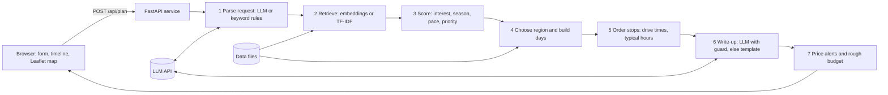

# Karnataka AI Travel Planner

An AI travel planner that builds day-by-day Karnataka itineraries from a traveller's interests, time, budget and preferred pace. Places come from a checked dataset, routes are built by an algorithm, and the language model only writes the text.

**Live demo:** [[Live Demo](https://ai-travller-karnataka.onrender.com/)]
(The free tier sleeps when idle, so the first load can take about a minute.)

**Hackathon problem statement:** 06, Travel and Tourism. *Develop an AI-powered travel planner that creates personalized Karnataka itineraries based on a traveller's interests, available time, budget, and preferred type of experience.*

**Scope of this version:** a pilot on the Mysuru division (Mysuru, Kodagu, Chikkamagaluru, Hassan, Dakshina Kannada, Udupi, Chamarajanagar). It is data driven, so extending to another division is mostly adding data (see [Extending to another division](#extending-to-another-division)).

<!--
Add screenshots after you take them, then uncomment:


-->

## Contents

- [Features](#features)
- [Why it is different from a chatbot prompt](#why-it-is-different-from-a-chatbot-prompt)
- [Try these trips](#try-these-trips)
- [How it works](#how-it-works)
- [Tech stack](#tech-stack)
- [Project structure](#project-structure)
- [Getting started](#getting-started)
- [Configuration](#configuration)
- [API](#api)
- [Deploying on Render](#deploying-on-render)
- [Data](#data)
- [Reliability and safety](#reliability-and-safety)
- [What we measured](#what-we-measured)
- [Limitations](#limitations)
- [Future scope](#future-scope)
- [Credits and attribution](#credits-and-attribution)

## Features

- **Plain-language or form input.** Type "3 days of palaces and local food around Mysuru, relaxed, in December" or use the form (days, travellers, interests, month, start area, pace, budget, stay type).
- **Day-by-day timeline** with arrival and departure times, drive time and distance between stops, and a lunch break.
- **Interactive map** with one coloured route per day.
- **"Why this place"** for every stop (interest match, season fit, must-see status).
- **Region first, then days.** The planner picks a compact group of areas for the trip length, then builds each day around one area, so long drives happen between days, not between every stop.
- **Opening-hours aware.** Stops must fit typical opening windows, and safari or trek days may start earlier.
- **Honest notes.** If a request cannot be fully met (for example wildlife places are off-season in July), the page says so.
- **Price alerts per area**, shown upfront (for example Coorg and Kabini are flagged as pricey, with peak months), plus a rough cost panel for entry fees and an optional stay estimate checked against the budget.
- **Works without AI.** With no API key, or when the AI is busy, the full plan still appears with plain text.
- **Save as PDF** through the browser's print dialog.

## Why it is different from a chatbot prompt

| | A plain chatbot | This planner |
|---|---|---|
| Who picks the places | The language model, from memory | An algorithm, from a checked dataset |
| Is the day doable? | Not checked | Drive times, typical hours, pace and day limits |
| Unsupported claims | Can slip into the text | Sentences naming other places, prices or unsupported claims are replaced |
| A request it cannot meet | Often stays silent | Says so on the page |
| If the AI is down | No answer | The full itinerary still appears |

## Try these trips

1. `3 days of palaces, heritage and local food around Mysuru, relaxed, in December`
2. `Weekend by the coast with 3 friends: beaches and Udupi food, under 15k`
3. `4 days of waterfalls and misty hills in Chikkamagaluru in July, packed`

Untick **Write it with AI** to see the same plan with plain template text.

## How it works



1. **Parse.** The LLM turns free text into days, interests, month, pace, start area, travellers and budget. A keyword parser is the backup. Values found in the message override form defaults, and the page shows what it understood.
2. **Retrieve.** Places are matched to the request by meaning (sentence-transformers locally, TF-IDF on small hosts).
3. **Score.** `score = (0.45 x semantic + 0.40 x interest match + 0.15 x priority) x season x pace`. Every interest is guaranteed candidates, so one popular interest cannot crowd out another.
4. **Region and days.** The planner picks the best compact set of areas for the trip length (longer trips may use more areas, never ones too far apart), then allocates each day to the area whose next day is worth most. If the compact region cannot fill all days, it widens one step.
5. **Order and time.** Within a day it tries every order (up to 6 stops) and keeps the shortest feasible one that respects typical opening windows, a lunch break, the day's time limit and the longest allowed single drive.
6. **Write-up.** The LLM describes only the chosen stops. A guard then checks every sentence (see [Reliability and safety](#reliability-and-safety)).
7. **Alerts and budget.** Price alerts come from `data/city_stay_costs.csv`, and the cost panel adds entry fees and an optional stay estimate.

Drive times are estimates (straight-line distance times a road factor, slower on ghat roads), not live routing.

## Tech stack

| Layer | Tools |
|---|---|
| Frontend | Single HTML page, vanilla JavaScript, Leaflet and OpenStreetMap tiles |
| Backend | Python 3.10+, FastAPI, Uvicorn, Pydantic |
| Search | sentence-transformers (`all-MiniLM-L6-v2`) locally, scikit-learn TF-IDF fallback, NumPy |
| Planning | Custom scoring, region selection, day builder and exact shortest-path ordering |
| LLM | Any of Anthropic, Gemini, or an OpenAI-compatible API (we used `openai/gpt-oss-120b` on Groq's free tier), called over plain HTTPS |
| Data | CSV files built from Wikipedia, Wikivoyage and OpenStreetMap, then reviewed by hand |
| Hosting | Render (free web service) |

## Project structure

```
.
├── backend/
│   ├── main.py            FastAPI app: API routes and static page
│   ├── service.py         the planner end to end (cache, notes, budget)
│   ├── llm.py             LLM client, request parsing, grounded write-up and guards
│   ├── routing.py         region choice, days, stop order, timeline
│   ├── hours.py           typical opening windows by kind of place
│   ├── scoring.py         interest, season, pace and priority scoring
│   ├── retrieval.py       embeddings with TF-IDF fallback
│   ├── data_loader.py     CSV loading and validation
│   ├── stays.py           city price alerts and stay estimate
│   ├── requirements.txt
│   └── (data tools)       collect_places_v2.py, fill_planner_fields.py, apply_manual_fixes.py,
│                          check_coords.py, remove_places.py, test_queries.py, test_llm_live.py, debug_scores.py
├── frontend/
│   └── index.html         the web page
├── data/
│   ├── places_v1.csv              the dataset the app loads
│   ├── city_stay_costs.csv        price levels, ranges and alerts per area, with sources
│   ├── manual_coords.csv          hand-set coordinates that override everything
│   └── karnataka_mysuru_division_places.csv   the source place list
├── render.yaml            Render deployment blueprint
├── .env.example           all settings, no secrets
└── README.md
```

## Getting started

Requires Python 3.10 or newer.

```bash
git clone <your repository url>
cd <repository folder>

python -m venv .venv
source .venv/bin/activate            # Windows: .venv\Scripts\activate

pip install -r backend/requirements.txt
pip install sentence-transformers    # optional: better search, large download

cp .env.example .env                 # then edit .env (see Configuration)

cd backend
uvicorn main:app --reload --port 8000
```

Open http://localhost:8000. With no LLM key set, the app still works and writes template text.

### Checks you can run (from `backend/`)

```bash
python data_loader.py ../data/places_v1.csv        # validates the dataset
python test_queries.py ../data/places_v1.csv       # search quality on 12 sample queries
python routing.py ../data/places_v1.csv --days 3 --interests heritage,food --month 12 --pace balanced
python test_llm_live.py                            # runs the real LLM on three trips (needs a key)
```

## Configuration

Copy `.env.example` to `.env`. Never commit `.env`.

| Variable | Purpose | Default |
|---|---|---|
| `LLM_PROVIDER` | `anthropic`, `gemini`, or `openai` (any OpenAI-compatible API such as Groq) | none |
| `LLM_API_KEY` | your key; leave empty for template mode | empty |
| `LLM_MODEL` | model name exactly as in your provider's dashboard | `claude-haiku-5-5` for `anthropic` |
| `LLM_BASE_URL` | only for `openai`, for example `https://api.groq.com/openai/v1` | OpenAI's URL |
| `LLM_ENABLED` | set to `false` to force template text | `true` |
| `LLM_TIMEOUT` | seconds per LLM call | `25` |
| `LLM_REASONING_EFFORT` | `low`, `medium` or `high` for reasoning models (remove if the provider rejects it) | unset |
| `LLM_EXTRA_TOKENS` | extra output budget for reasoning models | `0` |
| `LLM_RETRIES` | retries after a rate-limit or server error | `2` |
| `LLM_MAX_WAIT` | longest single wait for a rate limit, seconds | `12` |
| `LLM_MAX_TOTAL_WAIT` | longest total waiting per plan, seconds | `20` |
| `LLM_TPM_LIMIT` | keep our own tokens per minute under this (0 = off) | `0` |
| `PLAN_CACHE_TTL` | seconds to remember results of identical requests (0 = off) | `1800` |
| `PLAN_CACHE_MAX` | maximum remembered results | `100` |
| `RETRIEVAL_BACKEND` | `auto`, `st` (embeddings) or `tfidf` (light) | `auto` |
| `DATA_PATH`, `STAYS_PATH` | alternative data file locations | `data/...` |
| `ALLOWED_ORIGINS` | CORS origins, comma separated | `*` |

### Using Groq (free tier)

```
LLM_PROVIDER=openai
LLM_BASE_URL=https://api.groq.com/openai/v1
LLM_API_KEY=your_groq_key
LLM_MODEL=openai/gpt-oss-120b
LLM_REASONING_EFFORT=low
LLM_EXTRA_TOKENS=800
LLM_TPM_LIMIT=7000
```

Free-tier limits change, so check your provider's console. The app handles a rate limit by waiting the time the provider asks (within the limits above), then falling back to template text, and the page tells the traveller what happened.

## API

The page uses these endpoints; you can call them directly.

- `GET /api/health` returns `{"ok": true, "places": 68, "llm": "..."}`.
- `GET /api/meta` returns the categories, areas, months, paces and stay types used by the form.
- `POST /api/plan` builds an itinerary.

Request (all fields optional):

```json
{
  "days": 3,
  "interests": ["heritage", "food"],
  "month": 12,
  "pace": "relaxed",
  "start_cluster": "Mysuru City",
  "travelers": 2,
  "budget_inr": 25000,
  "stay_type": "mid",
  "free_text": "temples and good local food",
  "use_llm": true
}
```

Response (abbreviated):

```json
{
  "understood": { "days": 3, "pace": "relaxed", "parsed_by": "llm", "from_message": ["days", "pace"] },
  "plan": {
    "region": { "clusters": ["Mysuru City"], "note": "Based around Mysuru City, so ..." },
    "days": [{ "day": 1, "base_cluster": "Mysuru City", "start_time": "09:00", "end_time": "17:11",
               "stops": [{ "name": "Mysore Palace", "arrive": "10:46", "depart": "12:46",
                           "typical_hours": "10:00 to 17:30", "reasons": ["..."] }] }],
    "warnings": []
  },
  "narrative": { "source": "llm", "title": "...", "intro": "...", "days": [], "tips": [] },
  "alerts": [{ "cluster": "Coorg", "price_level": "high", "alert": "..." }],
  "budget": { "known_total_inr": 7300, "message": "..." },
  "coverage_notes": [],
  "meta": { "ai_status": "ok", "cached": false, "seconds": 3.4 }
}
```

`narrative.source` is `llm`, `mixed` (some sentences replaced) or `template`. `meta.ai_status` is `ok`, `busy`, `error` or `off`.

## Deploying on Render

The backend serves the page too, so there is one URL to deploy. `render.yaml` describes the service.

1. Push the repository to GitHub, including `data/places_v1.csv` and `data/city_stay_costs.csv`.
2. In Render choose **New, then Blueprint**, and select the repository.
3. Add the two secrets in the service's Environment tab: `LLM_API_KEY` and `LLM_MODEL`.
4. Open `/api/health` on your Render URL. You want `ok: true` and the number of places.

If you create a plain Web Service instead: leave **Root Directory empty**, build with `pip install -r requirements.txt`, start with `cd backend && uvicorn main:app --host 0.0.0.0 --port $PORT`, and set `RETRIEVAL_BACKEND=tfidf`.

Free-tier notes: 512 MB of memory is why the deployed app uses the lighter TF-IDF search, the service sleeps after about 15 minutes of no traffic (a free uptime pinger on `/api/health` keeps it awake), and the CPU is small, so a plan can take several seconds. Results of repeated requests are cached.

## Data

The dataset has 68 places in 8 areas and 9 interest types (heritage, culture, spiritual, nature, wildlife, beach, adventure, food, hill-station).

Each place has an id, name, area, coordinates, categories, typical visit hours, best months, pace intensity, entry fee (blank when unknown), a short description and a source link.

### Building and checking the data

| Script (in `backend/`) | What it does |
|---|---|
| `collect_places_v2.py` | Collects coordinates and text from Wikipedia, Wikivoyage, Wikidata and OpenStreetMap. Coordinates must agree across sources and lie near the place's town; wrong-page matches are rejected. Writes a report of rows needing review. |
| `fill_planner_fields.py` | Sets visit hours, best months and pace from rules, with hand overrides for the main sights. |
| `apply_manual_fixes.py` | Adds hand-written keyword tags for places with thin text. |
| `check_coords.py` | Flags duplicate coordinates, outliers and suspicious wiki-title matches. |
| `data_loader.py` | Validates the final file the app loads. |
| `remove_places.py` | Removes places by id from one or more CSV files, with backups. |

Hand-set coordinates go in `data/manual_coords.csv` and always win.

### Price alerts

`data/city_stay_costs.csv` has one row per area: price level, hostel, budget, mid-range and luxury ranges, peak months, an alert shown upfront, a confidence level and source URLs. These are estimates from public travel and booking pages, not live rates.

### Extending to another division

Adding places is mostly data: add rows to the source list, then run the pipeline above. A few small settings also need entries:

- `CLUSTER_ALIASES` in `backend/llm.py` so the text parser recognises the new area names.
- `HILLY` and `COASTAL` in `backend/routing.py` so drive times use the right road speeds.
- A row in `data/city_stay_costs.csv` for each new area.
- Keyword rules in `backend/hours.py` if the new places need different typical hours.

## Reliability and safety

- **The model never chooses places.** It reads the request and describes the stops the algorithm already chose.
- **Grounding guard.** Every AI sentence is rejected and replaced by template text if it names a dataset place that is not in the plan, includes a price, uses a number the data does not support, or uses promotional words the place's own facts do not use.
- **Fallbacks.** No key, an AI error or a rate limit all result in a complete plan with template text, and the page says why.
- **Rate-limit handling.** Waits the provider's requested time within a budget, optionally paces its own token use, and caches good results so repeated requests cost nothing. Fallback results are never cached.
- **Input handling.** All fields are validated and clamped, and AI text is escaped in the page. The user's message is treated as data, not instructions.
- **Secrets.** API keys live only in environment variables. `.env` is git-ignored and `.env.example` documents every setting.

## What we measured

- **Routing (internal test).** On 300 random requests using a test set with approximate coordinates, comparing the first routing version with the final one: days mixing far-apart areas fell from 446 to 100, stops outside typical opening hours fell from 564 to 0, and plans with a day-to-day transfer over 3 hours fell from 189 to 75. The final version returned fewer days than asked for some long trips in that test, and says so on the page.
- **AI layer (live runs on a free tier).** About 1.5 to 5 seconds of writing time and roughly 2,000 to 2,700 tokens per plan, with no cut-off replies.
- **Search.** Precision at 5 on 12 sample queries improved from 0.75 to 0.85 as the data was cleaned (checked against our own category tags, so treat it as a debugging signal, not a benchmark).

## Limitations

- Pilot coverage: the Mysuru division only (68 places).
- Opening hours are typical windows, not live, and closed days are not modelled. Travellers should check before going.
- Entry fees are only partly known and are shown as unknown, not guessed. Stay prices are typical ranges, not live rates.
- Drive times are estimates, not live routing.
- Budget is checked against the plan but does not yet change which places are chosen.
- A safari day holds one safari, so wildlife-only trips can be thin.
- On the free deployment, search uses TF-IDF, so free-text matching is rougher than with embeddings. The interest selection drives most of the planning either way.

## Future scope

Live opening hours and weather, live routing, hotel and booking links, budget-aware place selection, more divisions (Bengaluru next), Kannada and Hindi output, and an offline mode.

## Credits and attribution

- Place facts and descriptions are derived from Wikipedia and Wikivoyage (CC BY-SA 4.0) and Wikidata (CC0). Map data and geocoding are from OpenStreetMap contributors (ODbL).
- Map display: Leaflet with OpenStreetMap tiles.
- LLM text is generated through the provider configured in `.env`.

Author: Siddhant Dakhore